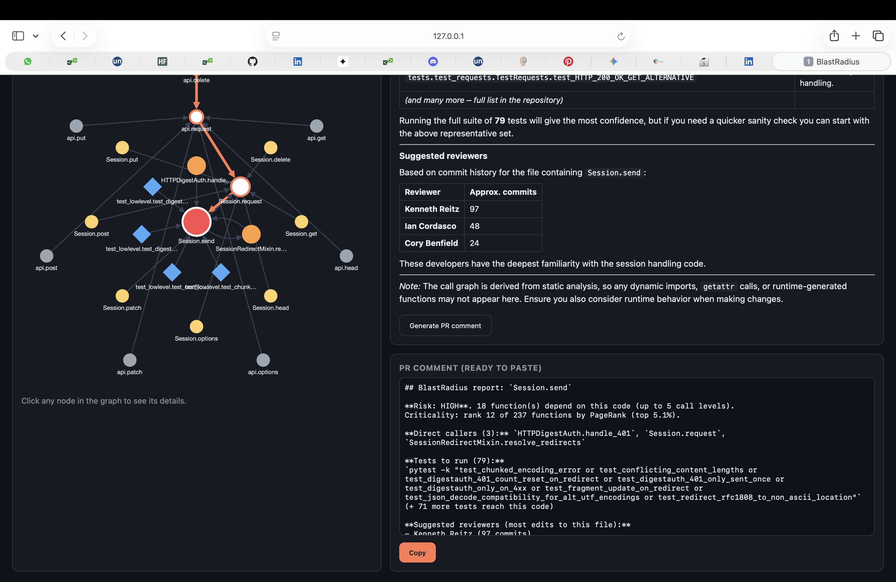

# BlastRadius

**Team Why Graph** - Graph Hacks 2026 (WeMakeDevs x FalkorDB), Track 01: Agents That Act on Connected Data

> Git blame tells you who wrote the code. BlastRadius tells you what will break if you change it, and shows the path.

**Demo video:** TODO_ADD_LINK



## The problem

In a large codebase, changing one function can silently affect many others. Developers (especially new open source contributors, who are afraid of breaking something they do not understand) have to search by hand or run the whole test suite. The question "what depends on this?" is purely about connections, which is where a plain language model is weak and a graph is strong.

## What it does

Ask in plain English: *"What breaks if I change prepare_request? Which tests should I run and who should review?"*

1. An LLM agent reads the list of available tools and chooses which to call (tool selection through MCP).
2. The tools run fixed, tested graph queries and algorithms on FalkorDB. The agent never writes raw Cypher.
3. The dashboard shows the neighbourhood of the changed function (colour = distance, node size = importance) and animates the exact path the answer relies on.
4. One click generates a ready-to-paste pull request comment with risk level, tests to run and reviewers.

Example on `psf/requests` (615 functions, 1058 call edges): changing `Session.prepare_request` affects 16 functions, 49 tests reach it, and the top reviewers by edit history are Kenneth Reitz, Ian Cordasco and Cory Benfield.

## How it works

```
GitHub repo --> parser (Python ast + git log) --> FalkorDB graph
                                                       ^
question --> LLM agent --> MCP tools (graph queries and algorithms)
                  |
                  +--> answer + highlighted path + PR comment --> dashboard
```

## Graph model

| Element | Type | Meaning |
|---|---|---|
| Function | node | a function or method (name, file, is_test, in_tests) |
| Person | node | a contributor (from git history) |
| CALLS | edge | function A calls function B |
| EDITED | edge | a person edited the file containing the function (commit count) |

## Agent tools (served over MCP)

| Tool | Purpose | Graph technique |
|---|---|---|
| find_function | resolve a partial name to the exact function | property search |
| impact | everything that depends on a function, with distance | multi-hop traversal (up to 5 hops) |
| tests_for | tests that reach a function | traversal from test functions |
| experts | who edited this code most | aggregation over EDITED edges |
| explain_path | how two functions are connected | shortest path |
| criticality | most depended-on functions in the repo | PageRank (FalkorDB `algo.pageRank`) |

The PR comment (`report.py`) combines these: risk level comes from the number of dependents and the PageRank percentile.

## Track 01 checklist

- Multi-hop reasoning: `impact`, `tests_for`, `explain_path`
- Graph queries and algorithms as agent tools: PageRank, shortest path, traversal
- Tool selection through MCP: `server.py`, `agent.py`
- Actions based on what the graph shows: generated PR comment with risk level
- Explainable results: the reasoning path is highlighted in the graph

## Change Check: errors introduced by your change

Before you commit, BlastRadius compares your working copy with the last commit (or any two git refs) and answers: what will my change break?

1. It finds the functions you removed, renamed or whose signature changed (`ast`, nothing is executed).
2. It asks the graph who calls them, then checks every call site against the new signature.
3. It reports only problems **introduced by your change**: calls that were already wrong before are ignored.
4. For each definite problem it suggests a fix and re-checks that the fixed call matches the new signature. Simple cases (a new required argument) are fixed by rule, with `None` as a placeholder you must replace; harder ones are drafted by the LLM and marked as AI-suggested.
5. It writes a `git apply`-able patch, lists the tests to run, and never commits or applies anything by itself.

Demo on `psf/requests`: `scripts/demo.sh break` makes `Session.prepare_request` require a new argument; Change Check finds 13 broken calls (12 tests and `Session.request`), proposes fixes, and after `scripts/demo.sh fix` it reports 0 new problems. `scripts/demo.sh reset` restores the repo.

What it can and cannot see: removed or renamed functions and changed parameters are detected statically. Changes to what a function does inside (logic, return values) cannot be checked statically, so those are reported as "run these tests".

## Why a graph? A small test

We asked the same question ("what depends on `Session.prepare_request`?") to a plain LLM that was given only `sessions.py`. The graph found 16 dependents; the LLM found 8, and missed all the functions in `api.py`. It invented no names, it just could not see the other file. This is an illustrative check, not a rigorous benchmark: a larger context window helps on small repos, but whole repositories do not fit in a prompt, and the graph also returns a verifiable path. Run it yourself with `python compare.py`.

## Limitations (honest list)

- Python only. The parser uses `ast` and never executes the code.
- Calls are matched by name. Common method names (`get`, `items`, ...) are skipped and `self.x()` calls are matched inside the same file first. This cut call edges on `requests` from 1754 to 1058, but dynamic dispatch, aliases and decorators are still not resolved.
- Reviewers come from file-level git history, not function-level.
- Static analysis can both miss calls and suggest tests that only reach a function indirectly.

## Related work

Impact analysis is not new: IDE "find usages", static dependency graph tools, and decision-tracking tools such as Trailstone (which records decisions and flags work built on a reversed decision) exist. BlastRadius combines a queryable code graph, graph algorithms exposed as agent tools, a visible reasoning path and a generated action, and is built for the graph-native questions an LLM alone answers poorly.

## Quick start

Requires Python 3.10+ and Docker.

```
git clone https://github.com/triyanshag777/blastradius.git
cd blastradius
python3 -m venv .venv && source .venv/bin/activate
pip install -r requirements.txt
cp .env.example .env        # then put your key in .env (any OpenAI-compatible provider)
docker run -d --name falkordb -p 6379:6379 -p 3000:3000 -v falkordb_data:/var/lib/falkordb/data falkordb/falkordb:latest
python load_fixture.py fixtures/requests_graph.json
uvicorn app:app --port 8000
```

Open http://localhost:8000 and click Example 1.

To analyse your own repository (needs the full git history):

```
python load_graph.py /path/to/repo
python load_authors.py /path/to/repo
```

`fixtures/requests_graph.json` is a snapshot produced by our own parser (`export_fixture.py`) from `psf/requests`, so the demo works without cloning that repo.

## Project layout

- `parser.py`: finds functions and calls with `ast`
- `load_graph.py`, `load_authors.py`, `load_fixture.py`, `export_fixture.py`: build the FalkorDB graph
- `tools.py`, `server.py`: graph tools and the MCP server
- `agent.py`: LLM agent loop (OpenAI-compatible API, tools discovered through MCP)
- `report.py`: PR comment generator
- `app.py`, `index.html`: FastAPI backend and dashboard (Cytoscape.js)
- `compare.py`: the "Why a graph?" test

## Built during the event

This project was started and built during Graph Hacks (15-18 October 2026). Development notes are in `NOTES.md`.
